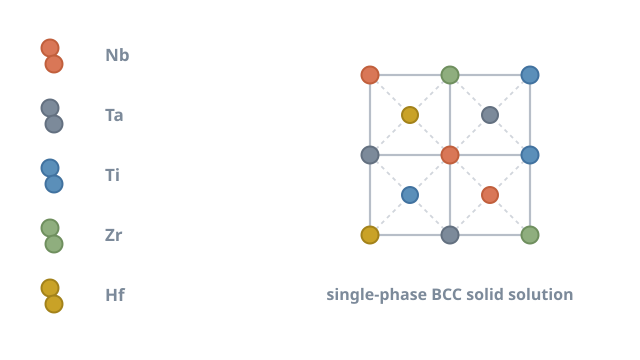

# High-entropy superconductors: order from chemical chaos

<figure class="post-hero" markdown>

</figure>

Metallurgy has long followed a simple recipe: take one main metal and add
small amounts of others. High-entropy alloys break that rule. They mix five or more
elements in near-equal amounts, and some of them superconduct. They may help solve one
of fusion energy's hardest materials problems.

<!-- more -->

## Superconductivity in one minute

Below a critical temperature, Tc, some materials lose all electrical
resistance. Electrons pair up into **Cooper pairs**, bound together through vibrations of
the crystal lattice. The pairs then move through the material without scattering.[^1]

<figure markdown>

<figcaption>On cooling, resistance falls gradually, then drops to exactly zero at Tc.</figcaption>
</figure>

Zero resistance means a coil can carry a huge current without heating. That is why
superconducting magnets produce fields far stronger than ordinary electromagnets.

## The fusion magnet problem

Fusion reactors confine plasma hotter than the Sun's core using intense magnetic fields.
Building those magnets demands superconducting wire that is both high-performing and
mechanically tough.

Today's workhorse conductors involve a trade-off:

- **Nb–Ti** is a ductile alloy that is easy to draw into wire, but its Tc is
  only about 9 K.
- **Nb3Sn** performs better at high fields, but it is a brittle intermetallic
  compound. Its properties are also sensitive to strain.[^2]

A conductor combining Nb–Ti's ductility with better superconducting performance would be
valuable. This is where high-entropy alloys come in.

## What is a high-entropy alloy?

In 2004, two groups independently explored alloys made of many principal elements in
equal proportions.[^3][^4] Intuition suggested such mixtures would form many brittle
phases. Instead, some formed a **single, simple crystal structure**.

<figure markdown>

<figcaption>Five elements share one body-centred cubic (BCC) lattice, with each site occupied at random.</figcaption>
</figure>

The name comes from configurational entropy. For *n* elements in equal amounts, the
mixing entropy is

$$
\Delta S_{\text{conf}} = R \ln n
$$

where *R* is the gas constant. For five elements this is about 1.61 *R*. At high
temperature, this entropy term can stabilise a random solid solution over competing
ordered phases.[^3]

## Superconducting high-entropy alloys

In 2014, Koželj and colleagues reported the first superconducting high-entropy alloy:
Ta–Nb–Hf–Zr–Ti, with a BCC structure and a Tc of about 7.3 K.[^5] Later work
showed its zero resistance survives pressures up to 190 GPa, a remarkable robustness.[^6]

Since then, many related alloys have been studied.[^7] Their Tc follows trends
with the average number of valence electrons per atom. This echoes an empirical rule
first noted by Matthias in the 1950s.[^8]

## Searching a huge composition space

With ten candidate metals and freedom over proportions, the number of possible alloys is
enormous. Making and testing each one is not practical. Machine learning helps narrow the
search. Composition-based descriptors, such as averaged elemental properties, allow a
model to learn from known alloys.[^9]

I built a two-stage approach. First, a classifier predicts whether a composition forms a
stable single-phase BCC structure. Second, a set of regression models predicts
Tc for the compositions that pass. You can try both on my
[Machine Learning](../../machine-learning.md) page.

## My work

At The University of Queensland, I am developing a ductile superconductor based on
high-entropy alloys for fusion applications. Machine learning guides which compositions
to synthesise. Experiments then test both the superconducting properties and the
mechanical behaviour that wire manufacturing requires.

!!! tip "The big picture"
    High-entropy alloys turn chemical disorder into a design tool. For superconductors,
    the goal is a conductor that is both strong in high fields and easy to manufacture.

[Back to my research](../../research.md#hes){ .md-button }

## References

[^1]: Bardeen, J., Cooper, L. N., & Schrieffer, J. R. (1957). Theory of superconductivity. *Physical Review*, 108, 1175–1204. [doi:10.1103/PhysRev.108.1175](https://doi.org/10.1103/PhysRev.108.1175)
[^2]: Godeke, A. (2006). A review of the properties of Nb3Sn and their variation with A15 composition, morphology and strain state. *Superconductor Science and Technology*, 19, R68–R80. [doi:10.1088/0953-2048/19/8/R02](https://doi.org/10.1088/0953-2048/19/8/R02)
[^3]: Yeh, J.-W., Chen, S.-K., Lin, S.-J., Gan, J.-Y., Chin, T.-S., Shun, T.-T., Tsau, C.-H., & Chang, S.-Y. (2004). Nanostructured high-entropy alloys with multiple principal elements: Novel alloy design concepts and outcomes. *Advanced Engineering Materials*, 6, 299–303. [doi:10.1002/adem.200300567](https://doi.org/10.1002/adem.200300567)
[^4]: Cantor, B., Chang, I. T. H., Knight, P., & Vincent, A. J. B. (2004). Microstructural development in equiatomic multicomponent alloys. *Materials Science and Engineering: A*, 375–377, 213–218. [doi:10.1016/j.msea.2003.10.257](https://doi.org/10.1016/j.msea.2003.10.257)
[^5]: Koželj, P., Vrtnik, S., Jelen, A., Jazbec, S., Jagličić, Z., Maiti, S., Feuerbacher, M., Steurer, W., & Dolinšek, J. (2014). Discovery of a superconducting high-entropy alloy. *Physical Review Letters*, 113, 107001. [doi:10.1103/PhysRevLett.113.107001](https://doi.org/10.1103/PhysRevLett.113.107001)
[^6]: Guo, J., Wang, H., von Rohr, F., et al. (2017). Robust zero resistance in a superconducting high-entropy alloy at pressures up to 190 GPa. *Proceedings of the National Academy of Sciences*, 114, 13144–13147. [doi:10.1073/pnas.1716981114](https://doi.org/10.1073/pnas.1716981114)
[^7]: Sun, L., & Cava, R. J. (2019). High-entropy alloy superconductors: Status, opportunities, and challenges. *Physical Review Materials*, 3, 090301. [doi:10.1103/PhysRevMaterials.3.090301](https://doi.org/10.1103/PhysRevMaterials.3.090301)
[^8]: Matthias, B. T. (1955). Empirical relation between superconductivity and the number of valence electrons per atom. *Physical Review*, 97, 74–76. [doi:10.1103/PhysRev.97.74](https://doi.org/10.1103/PhysRev.97.74)
[^9]: Ward, L., Agrawal, A., Choudhary, A., & Wolverton, C. (2016). A general-purpose machine learning framework for predicting properties of inorganic materials. *npj Computational Materials*, 2, 16028. [doi:10.1038/npjcompumats.2016.28](https://doi.org/10.1038/npjcompumats.2016.28)
