# High-entropy superconductors: order from chemical chaos

<figure class="post-hero" markdown>

</figure>

Metallurgy has long followed a simple recipe: take one main metal and add
small amounts of others. High-entropy alloys break that rule. They mix five or more
elements in near-equal amounts, and some of them superconduct. They may help solve one
of fusion energy's hardest materials problems.

<!-- more -->

## Superconductivity in one minute

Below a critical temperature, Tc, some materials lose all electrical
resistance. Electrons pair up into **Cooper pairs**, bound together through vibrations of
the crystal lattice. The pairs then move through the material without scattering.[^bcs]

<figure markdown>

<figcaption>On cooling, resistance falls gradually, then drops to exactly zero at Tc.</figcaption>
</figure>

Zero resistance means a coil can carry a huge current without heating. That is why
superconducting magnets produce fields far stronger than ordinary electromagnets.

## The fusion magnet problem

A tokamak confines plasma hotter than the Sun's core inside a ring of magnetic field.
The magnets must carry enormous currents in high fields, survive huge mechanical forces,
and work for decades.

ITER, the international fusion experiment in France, shows the scale. Its magnet system
uses 18 toroidal field coils and a central solenoid wound from Nb3Sn, plus
poloidal field coils wound from Nb–Ti.[^iter] All use **cable-in-conduit** conductors:
hundreds of superconducting strands twisted into a cable and sealed inside a steel jacket,
with helium flowing through to cool them.[^iter]

Today's conductor choices each involve a trade-off:

| Conductor | Tc | Mechanical behaviour | Fusion use |
| --- | --- | --- | --- |
| **Nb–Ti** | about 9 K | Ductile alloy; easy to draw into wire | Lower-field coils (ITER poloidal field) |
| **Nb3Sn** | about 18 K | Brittle intermetallic; strain sensitive | High-field coils (ITER toroidal field, central solenoid) |
| **REBCO** (high-temperature superconductor) | about 90 K | Thin ceramic layer on a metal tape | Compact high-field tokamaks |
| **Ta–Nb–Hf–Zr–Ti** (high-entropy alloy) | about 7 K | Metallic BCC alloy | Research stage |

Values from Larbalestier et al.,[^larb] Godeke[^godeke] and Koželj et al.[^kozelj]

Nb3Sn performs well at high field, but it is so brittle that coils are usually
wound first and reacted afterwards ("wind and react").[^godeke] High-temperature
superconductors are advancing fast. In 2021, a large REBCO test coil for the SPARC
tokamak reached a peak field of about 20 T.[^sparc] Even so, a conductor combining
Nb–Ti's ductility with better superconducting performance would be valuable. This is
where high-entropy alloys come in.

## What is a high-entropy alloy?

In 2004, two groups independently explored alloys made of many principal elements in
equal proportions.[^yeh][^cantor] Intuition suggested such mixtures would form many
brittle phases. Instead, some formed a **single, simple crystal structure**.

<figure markdown>

<figcaption>Five elements share one body-centred cubic (BCC) lattice, with each site occupied at random.</figcaption>
</figure>

The name comes from configurational entropy. For *n* elements in equal amounts, the
mixing entropy is

Δ<i>S</i>conf = <i>R</i> ln <i>n</i>

where *R* is the gas constant. For five elements this is about 1.61 *R*. At high
temperature, this entropy term can stabilise a random solid solution over competing
ordered phases.[^yeh]

## Superconducting high-entropy alloys

In 2014, Koželj and colleagues reported the first superconducting high-entropy alloy:
Ta–Nb–Hf–Zr–Ti, with a BCC structure and a Tc of about 7.3 K.[^kozelj] Later
work showed its zero resistance survives pressures up to 190 GPa, a remarkable
robustness.[^guo]

Since then, many related alloys have been studied.[^suncava] Their Tc follows
trends with the average number of valence electrons per atom. This echoes an empirical
rule first noted by Matthias in the 1950s.[^matthias] Three design questions now drive
the field:

1. **Can Tc and the upper critical field be raised** while keeping a single
   BCC phase?
2. **Does chemical disorder help pin magnetic flux**, which sets how much current a wire
   can carry in a field?
3. **Can the alloy stay ductile** enough to be drawn into fine filaments?

## How superconducting wire is made today

A practical fusion conductor is not a single wire. It is a composite of many fine
superconducting filaments in a copper matrix. The copper carries current safely if the
superconductor briefly fails, and it conducts heat away.

<figure class="figure-wide" markdown>
{ target=_blank title="Open full size" }
<figcaption>The conventional route for multifilamentary superconducting wire and fusion coils.</figcaption>
</figure>

For a ductile alloy such as Nb–Ti, the route looks like this:[^larb][^godeke]

1. **Alloy melting.** The alloy is melted, typically by vacuum arc or electron-beam
   melting, to get a clean, homogeneous ingot.
2. **Homogenisation.** A long heat treatment evens out the composition.
3. **Rod making.** The ingot is worked into rods and clad in copper.
4. **Billet assembly.** Thousands of hexagonal copper-clad rods are stacked inside a
   copper can.
5. **Hot extrusion.** The billet is pushed through a die, bonding everything into one
   composite.
6. **Wire drawing.** The composite is drawn down through many dies. Intermediate heat
   treatments create nanoscale precipitates that pin magnetic flux.[^larb]
7. **Cabling.** Strands are twisted into a cable, then jacketed (cable-in-conduit).
8. **Coil winding.** The cable is wound into the final coil.

Brittle Nb3Sn needs a different trick. Its precursors (niobium and tin, or
bronze) are drawn while still ductile. The compound forms only in a final reaction heat
treatment, usually after the coil is wound.[^godeke] A **ductile superconducting
high-entropy alloy** could follow the simpler Nb–Ti route, with no reaction step.

## See it made

<iframe src="https://www.youtube-nocookie.com/embed/GCJN7CP_DVQ" title="The making of the ITER toroidal field coils (ITER Organization)" loading="lazy" allow="accelerometer; encrypted-media; gyroscope; picture-in-picture" allowfullscreen></iframe>

The making of the ITER toroidal field coils, from the ITER Organization.

<iframe src="https://www.youtube-nocookie.com/embed/HrmUQTmq19Q" title="Manufacture of niobium-tin and niobium-titanium superconductors" loading="lazy" allow="accelerometer; encrypted-media; gyroscope; picture-in-picture" allowfullscreen></iframe>

How Nb3Sn and Nb–Ti superconducting wires are manufactured (Professor Harry Bhadeshia, University of Cambridge channel).

<iframe src="https://www.youtube-nocookie.com/embed/uHbbsjDiAYE" title="What are high entropy alloys? (Taylor Sparks)" loading="lazy" allow="accelerometer; encrypted-media; gyroscope; picture-in-picture" allowfullscreen></iframe>

An introduction to high-entropy alloys by materials scientist Taylor Sparks.

## Who makes fusion superconductors?

Superconducting strand is a specialised industry. For ITER's toroidal field coils alone,
suppliers across six ITER members (China, Europe, Japan, Korea, Russia and the United
States) produced more than 400 tonnes of Nb3Sn strand.[^iterstrand] Europe's
share was made by Bruker EAS in Germany and Oxford Superconducting Technology (OST) in
the United States, using the bronze and internal-tin routes respectively.[^boutboul]

## Searching a huge composition space

With ten candidate metals and freedom over proportions, the number of possible alloys is
enormous. Making and testing each one is not practical. Machine learning helps narrow the
search. Composition-based descriptors, such as averaged elemental properties, allow a
model to learn from known alloys.[^ward]

I built a two-stage approach. First, a classifier predicts whether a composition forms a
stable single-phase BCC structure. Second, a set of regression models predicts
Tc for the compositions that pass. You can try both on my
[Machine Learning](../../machine-learning.md) page.

## My work

At The University of Queensland, I am developing a ductile superconductor based on
high-entropy alloys for fusion applications. Machine learning guides which compositions
to synthesise. Experiments then test both the superconducting properties and the
mechanical behaviour that wire manufacturing requires.

!!! tip "The big picture"
    High-entropy alloys turn chemical disorder into a design tool. For superconductors,
    the goal is a conductor that is both strong in high fields and easy to manufacture.

[Back to my research](../../research.md#hes){ .md-button }

## References

[^bcs]: Bardeen, J., Cooper, L. N., & Schrieffer, J. R. (1957). Theory of superconductivity. *Physical Review*, 108, 1175–1204. [doi:10.1103/PhysRev.108.1175](https://doi.org/10.1103/PhysRev.108.1175)
[^iter]: Mitchell, N., Bessette, D., Gallix, R., Jong, C., Knaster, J., Libeyre, P., et al. (2008). The ITER magnet system. *IEEE Transactions on Applied Superconductivity*, 18, 435–440. [doi:10.1109/TASC.2008.921232](https://doi.org/10.1109/TASC.2008.921232)
[^larb]: Larbalestier, D., Gurevich, A., Feldmann, D. M., & Polyanskii, A. (2001). High-Tc superconducting materials for electric power applications. *Nature*, 414, 368–377. [doi:10.1038/35104654](https://doi.org/10.1038/35104654)
[^godeke]: Godeke, A. (2006). A review of the properties of Nb3Sn and their variation with A15 composition, morphology and strain state. *Superconductor Science and Technology*, 19, R68–R80. [doi:10.1088/0953-2048/19/8/R02](https://doi.org/10.1088/0953-2048/19/8/R02)
[^kozelj]: Koželj, P., Vrtnik, S., Jelen, A., Jazbec, S., Jagličić, Z., Maiti, S., Feuerbacher, M., Steurer, W., & Dolinšek, J. (2014). Discovery of a superconducting high-entropy alloy. *Physical Review Letters*, 113, 107001. [doi:10.1103/PhysRevLett.113.107001](https://doi.org/10.1103/PhysRevLett.113.107001)
[^sparc]: Whyte, D. G., LaBombard, B., Doody, J., et al., & Hartwig, Z. S. (2024). Experimental assessment and model validation of the SPARC toroidal field model coil. *IEEE Transactions on Applied Superconductivity*, 34, 1–18. [doi:10.1109/TASC.2023.3332823](https://doi.org/10.1109/TASC.2023.3332823)
[^yeh]: Yeh, J.-W., Chen, S.-K., Lin, S.-J., Gan, J.-Y., Chin, T.-S., Shun, T.-T., Tsau, C.-H., & Chang, S.-Y. (2004). Nanostructured high-entropy alloys with multiple principal elements: Novel alloy design concepts and outcomes. *Advanced Engineering Materials*, 6, 299–303. [doi:10.1002/adem.200300567](https://doi.org/10.1002/adem.200300567)
[^cantor]: Cantor, B., Chang, I. T. H., Knight, P., & Vincent, A. J. B. (2004). Microstructural development in equiatomic multicomponent alloys. *Materials Science and Engineering: A*, 375–377, 213–218. [doi:10.1016/j.msea.2003.10.257](https://doi.org/10.1016/j.msea.2003.10.257)
[^guo]: Guo, J., Wang, H., von Rohr, F., et al. (2017). Robust zero resistance in a superconducting high-entropy alloy at pressures up to 190 GPa. *Proceedings of the National Academy of Sciences*, 114, 13144–13147. [doi:10.1073/pnas.1716981114](https://doi.org/10.1073/pnas.1716981114)
[^suncava]: Sun, L., & Cava, R. J. (2019). High-entropy alloy superconductors: Status, opportunities, and challenges. *Physical Review Materials*, 3, 090301. [doi:10.1103/PhysRevMaterials.3.090301](https://doi.org/10.1103/PhysRevMaterials.3.090301)
[^matthias]: Matthias, B. T. (1955). Empirical relation between superconductivity and the number of valence electrons per atom. *Physical Review*, 97, 74–76. [doi:10.1103/PhysRev.97.74](https://doi.org/10.1103/PhysRev.97.74)
[^iterstrand]: ITER Organization (2013). *Toroidal field coils: Strand production passes 400 tonnes*. ITER Newsline. [iter.org](https://www.iter.org/node/17043)
[^boutboul]: Boutboul, T., Abaecherli, V., Berger, G., Hampshire, D., Parrell, J., Raine, M., et al. (2016). European Nb3Sn superconducting strand production and characterization for ITER TF coil conductor. *IEEE Transactions on Applied Superconductivity*, 26, 1–4. [doi:10.1109/TASC.2015.2512386](https://doi.org/10.1109/TASC.2015.2512386)
[^ward]: Ward, L., Agrawal, A., Choudhary, A., & Wolverton, C. (2016). A general-purpose machine learning framework for predicting properties of inorganic materials. *npj Computational Materials*, 2, 16028. [doi:10.1038/npjcompumats.2016.28](https://doi.org/10.1038/npjcompumats.2016.28)
