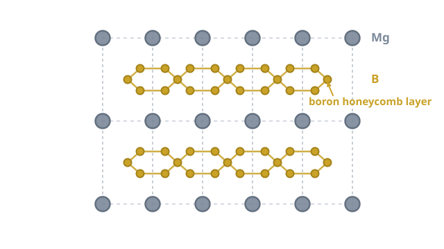

# Closing the loop: MgB₂ superconducting joints for MRI

<figure class="post-hero" markdown>

</figure>

An MRI scanner holds an extremely stable magnetic field for years, with
its power supply switched off. That trick depends on a few tiny connections inside the
magnet: the superconducting joints. My PhD focused on making those joints from a promising
superconductor, magnesium diboride.

<!-- more -->

## How an MRI magnet stays on

Most clinical MRI magnets are wound from niobium–titanium (Nb–Ti) wire and cooled in
liquid helium to about 4.2 K.[^1] Once the coil is energised, the circuit is closed with
a superconducting switch. The power supply is then disconnected. Current keeps
circulating with no driving voltage. This is called **persistent mode**.

The field is only as stable as the loop is perfect. Any residual resistance *R* in the
circuit makes the current decay with a time constant

$$
\tau = \frac{L}{R}
$$

where *L* is the coil inductance.[^2] MRI needs field drift measured in parts per million
over long periods. So the total resistance must be vanishingly small.[^1]

<figure markdown>

<figcaption>With a superconducting joint the field stays flat; any resistance makes it decay over time.</figcaption>
</figure>

The wire itself is superconducting. The weak points are the **joints**, where separate
lengths of wire must be connected. Every joint must also be superconducting.

## Why magnesium diboride?

In 2001, Nagamatsu and colleagues discovered that MgB2, a simple and
inexpensive compound, superconducts at 39 K.[^3] That is far above the roughly 9 K of
Nb–Ti.[^4]

<figure markdown>

<figcaption>MgB2 stacks graphite-like boron layers between layers of magnesium. Vibrations of the boron layers drive its superconductivity.</figcaption>
</figure>

This higher Tc matters for MRI. MgB2 magnets can run at about
10 to 20 K, cooled by cryocoolers instead of a large liquid helium bath.[^5] Helium is a
finite and increasingly costly resource, so reducing dependence on it is attractive.
Magnesium and boron are also abundant and cheap.[^4][^6]

## Why MgB₂ joints are hard

Joining MgB2 is much harder than joining Nb–Ti, for several reasons:[^5][^6]

- **It is brittle.** MgB2 is a ceramic-like compound. It cannot be welded or
  crimped like a ductile metal.
- **Magnesium is reactive and volatile.** Forming dense, well-connected
  MgB2 at the joint, rather than in a controlled wire, is difficult.
- **The wire is a composite.** MgB2 filaments sit inside metal sheaths. These
  must be opened and the superconducting cores connected without damaging them.
- **Grain connectivity is critical.** Current must pass through continuous,
  well-connected grains. Porosity and impurity phases block it.

Joints made from already *reacted* wire are especially challenging. The superconductor
has formed before joining, so the joint must create a new superconducting path between
two finished conductors.

## How a joint is judged

The decisive test is the **transport critical current, Ic**. A current is
passed through the joint at a set temperature and magnetic field. Ic is the
current at which resistance first appears. A good joint carries a current comparable to
the wire itself, under the conditions the magnet will see.

## My work

During my PhD at The University of Queensland, I developed a method for joining reacted
MgB2 for persistent-mode MRI magnets. The aim was ultra-low joint resistance
for stable circulating current and long-term field stability. The work combined
synthesis, heat treatment, microscopy and low-temperature transport measurements.

!!! note "Industry funded · IP protected"
    This project is industry funded, and its methods are under intellectual-property
    protection. Details and publications will follow once patent clearance allows.

[Back to my research](../../research.md#mgb2){ .md-button }

## References

[^1]: Lvovsky, Y., Stautner, E. W., & Zhang, T. (2013). Novel technologies and configurations of superconducting magnets for MRI. *Superconductor Science and Technology*, 26, 093001. [doi:10.1088/0953-2048/26/9/093001](https://doi.org/10.1088/0953-2048/26/9/093001)
[^2]: Iwasa, Y. (2009). *Case Studies in Superconducting Magnets: Design and Operational Issues* (2nd ed.). Springer. [doi:10.1007/b112047](https://doi.org/10.1007/b112047)
[^3]: Nagamatsu, J., Nakagawa, N., Muranaka, T., Zenitani, Y., & Akimitsu, J. (2001). Superconductivity at 39 K in magnesium diboride. *Nature*, 410, 63–64. [doi:10.1038/35065039](https://doi.org/10.1038/35065039)
[^4]: Larbalestier, D., Gurevich, A., Feldmann, D. M., & Polyanskii, A. (2001). High-Tc superconducting materials for electric power applications. *Nature*, 414, 368–377. [doi:10.1038/35104654](https://doi.org/10.1038/35104654)
[^5]: Parizh, M., Lvovsky, Y., & Sumption, M. (2017). Conductors for commercial MRI magnets beyond NbTi: Requirements and challenges. *Superconductor Science and Technology*, 30, 014007. [doi:10.1088/0953-2048/30/1/014007](https://doi.org/10.1088/0953-2048/30/1/014007)
[^6]: Buzea, C., & Yamashita, T. (2001). Review of the superconducting properties of MgB2. *Superconductor Science and Technology*, 14, R115–R146. [doi:10.1088/0953-2048/14/11/201](https://doi.org/10.1088/0953-2048/14/11/201)
