# Closing the loop: MgB₂ superconducting joints for MRI

<figure class="post-hero" markdown>

</figure>

An MRI scanner holds an extremely stable magnetic field for years, with
its power supply switched off. That trick depends on a few tiny connections inside the
magnet: the superconducting joints. My PhD focused on making those joints from a promising
superconductor, magnesium diboride.

<!-- more -->

## How an MRI magnet stays on

Most clinical MRI magnets are wound from niobium–titanium (Nb–Ti) wire and cooled in
liquid helium to about 4.2 K.[^lvovsky] Once the coil is energised, the circuit is closed
with a superconducting switch. The power supply is then disconnected. Current keeps
circulating with no driving voltage. This is called **persistent mode**.

The field is only as stable as the loop is perfect. Any residual resistance *R* in the
circuit makes the current decay with a time constant

<i>τ</i> = <i>L</i><i>R</i>

where *L* is the coil inductance.[^iwasa] MRI needs field drift measured in parts per
million over long periods. So the total resistance must be vanishingly small.[^lvovsky]

<figure markdown>

<figcaption>With a superconducting joint the field stays flat; any resistance makes it decay over time.</figcaption>
</figure>

The wire itself is superconducting. The weak points are the **joints**, where separate
lengths of wire must be connected. A large magnet contains many coil sections, a
persistent switch and leads, so it needs several joints. Every one must be
superconducting.[^iwasa]

## Why magnesium diboride?

In 2001, Nagamatsu and colleagues discovered that MgB2, a simple and
inexpensive compound, superconducts at 39 K.[^nagamatsu]

<figure markdown>

<figcaption>MgB2 stacks graphite-like boron layers between layers of magnesium. Vibrations of the boron layers drive its superconductivity.</figcaption>
</figure>

| | Nb–Ti | MgB2 |
| --- | --- | --- |
| Critical temperature | about 9 K | 39 K |
| Typical operating temperature in MRI | 4.2 K (liquid helium bath) | about 10 to 20 K (cryocooler) |
| Raw materials | Niobium, titanium | Magnesium, boron (abundant, low cost) |
| Mechanical behaviour | Ductile alloy | Brittle ceramic-like compound |

Sources: Larbalestier et al.,[^larb] Buzea and Yamashita,[^buzea] and Parizh et al.[^parizh]

This higher Tc matters for MRI. MgB2 magnets can run cooled by
cryocoolers, without a large liquid helium bath.[^parizh] Helium is a finite and
increasingly costly resource, so reducing dependence on it is attractive. Some designs go
further and use a frozen solid cryogen as a thermal buffer, keeping the magnet cold
through power cuts.[^solidcryo]

## How MgB₂ wire is made

MgB2 is too brittle to draw on its own. Instead, manufacturers use the
**powder-in-tube (PIT)** method: powder is sealed inside a metal tube and the whole
composite is drawn into wire.[^kumakura]

<figure class="figure-wide" markdown>
{ target=_blank title="Open full size" }
<figcaption>The conventional powder-in-tube route for MgB2 wire and coils.</figcaption>
</figure>

1. **Powder preparation.** In the *in situ* route, magnesium and boron powders are mixed
   (Mg + 2B). In the *ex situ* route, ready-made MgB2 powder is used.[^kumakura]
2. **Tube filling.** The powder is packed into a metal tube. A barrier layer, often
   niobium or iron, stops magnesium reacting with the outer sheath.
3. **Drawing and rolling.** The tube is reduced through dies and grooved rolls.
4. **Restacking.** Several mono-filament wires are bundled into a new tube to make a
   multifilament conductor.
5. **Final drawing.** The composite is drawn to its final diameter.
6. **Reaction heat treatment.** In the in situ route, heating under argon converts
   Mg + 2B into MgB2 inside the wire.
7. **Coil winding.** The wire is wound into coils, either before the reaction ("wind and
   react") or after it ("react and wind").[^musenich]
8. **Joints and magnet assembly.** Coils, switch and leads are joined into one
   superconducting circuit.

The in situ reaction shrinks in volume, leaving pores that block current. To get denser
superconductor, **internal magnesium infiltration** places a magnesium rod at the centre
of a boron layer. On heating, the magnesium infiltrates the boron and forms a dense
MgB2 layer.[^aimi]

## Who makes MgB₂ conductors?

A small number of companies produce MgB2 wire commercially. ASG
Superconductors in Genoa, Italy, makes long-length PIT wire. It has built a 0.5 T,
cryogen-free open MRI scanner wound with MgB2.[^modica][^asg] In the United
States, Hyper Tech Research develops wire made by internal magnesium
infiltration.[^aimi]

<iframe src="https://www.youtube-nocookie.com/embed/6lJ6BLvbX8k" title="Developing the MgB2 superconducting wire (ASG Superconductors)" loading="lazy" allow="accelerometer; encrypted-media; gyroscope; picture-in-picture" allowfullscreen></iframe>

ASG Superconductors: developing MgB2 wire, from powder synthesis to the final stage.

<iframe src="https://www.youtube-nocookie.com/embed/nva2HJY6PO0" title="MgB2 wire production facility (ASG Superconductors)" loading="lazy" allow="accelerometer; encrypted-media; gyroscope; picture-in-picture" allowfullscreen></iframe>

Inside ASG Superconductors' MgB2 wire production facility.

## Why MgB₂ joints are hard

Joining MgB2 is much harder than joining Nb–Ti, for several reasons:[^parizh][^buzea]

- **It is brittle.** MgB2 cannot be welded or crimped like a ductile metal.
- **Magnesium is reactive and volatile.** Forming dense, well-connected
  MgB2 at the joint, rather than in a controlled wire, is difficult.
- **The wire is a composite.** Filaments sit inside metal sheaths and barriers. These
  must be opened and the superconducting cores connected without damaging them.
- **Grain connectivity is critical.** Current must pass through continuous,
  well-connected grains. Porosity and impurity phases block it.

Researchers have pursued several strategies, and joints with very low resistance have
been reported.[^patel] Joints made from already *reacted* wire are especially
challenging. The superconductor has formed before joining, so the joint must create a new
superconducting path between two finished conductors.

## How a joint is judged

The decisive test is the **transport critical current, Ic**. A current is
passed through the joint at a set temperature and magnetic field. Ic is the
current at which resistance first appears. A good joint carries a current comparable to
the wire itself, under the conditions the magnet will see. Long-term persistent-mode
tests then measure any slow field decay directly.

## My work

During my PhD at The University of Queensland, I developed a method for joining reacted
MgB2 for persistent-mode MRI magnets. The aim was ultra-low joint resistance
for stable circulating current and long-term field stability. The work combined
synthesis, heat treatment, microscopy and low-temperature transport measurements.

!!! note "Industry funded · IP protected"
    This project is industry funded, and its methods are under intellectual-property
    protection. Details and publications will follow once patent clearance allows.

[Back to my research](../../research.md#mgb2){ .md-button }

## References

[^lvovsky]: Lvovsky, Y., Stautner, E. W., & Zhang, T. (2013). Novel technologies and configurations of superconducting magnets for MRI. *Superconductor Science and Technology*, 26, 093001. [doi:10.1088/0953-2048/26/9/093001](https://doi.org/10.1088/0953-2048/26/9/093001)
[^iwasa]: Iwasa, Y. (2009). *Case Studies in Superconducting Magnets: Design and Operational Issues* (2nd ed.). Springer. [doi:10.1007/b112047](https://doi.org/10.1007/b112047)
[^nagamatsu]: Nagamatsu, J., Nakagawa, N., Muranaka, T., Zenitani, Y., & Akimitsu, J. (2001). Superconductivity at 39 K in magnesium diboride. *Nature*, 410, 63–64. [doi:10.1038/35065039](https://doi.org/10.1038/35065039)
[^larb]: Larbalestier, D., Gurevich, A., Feldmann, D. M., & Polyanskii, A. (2001). High-Tc superconducting materials for electric power applications. *Nature*, 414, 368–377. [doi:10.1038/35104654](https://doi.org/10.1038/35104654)
[^buzea]: Buzea, C., & Yamashita, T. (2001). Review of the superconducting properties of MgB2. *Superconductor Science and Technology*, 14, R115–R146. [doi:10.1088/0953-2048/14/11/201](https://doi.org/10.1088/0953-2048/14/11/201)
[^parizh]: Parizh, M., Lvovsky, Y., & Sumption, M. (2017). Conductors for commercial MRI magnets beyond NbTi: Requirements and challenges. *Superconductor Science and Technology*, 30, 014007. [doi:10.1088/0953-2048/30/1/014007](https://doi.org/10.1088/0953-2048/30/1/014007)
[^solidcryo]: Patel, D., Hossain, M. S. A., Qiu, W., Jie, H., Yamauchi, Y., Maeda, M., et al. (2017). Solid cryogen: A cooling system for future MgB2 MRI magnet. *Scientific Reports*, 7, 43444. [doi:10.1038/srep43444](https://doi.org/10.1038/srep43444)
[^kumakura]: Kumakura, H., Matsumoto, A., Fujii, H., Kitaguchi, H., & Togano, K. (2002). Microstructure and superconducting properties of powder-in-tube processed MgB2 tapes. *Physica C: Superconductivity*, 382, 93–97. [doi:10.1016/S0921-4534(02)01204-2](https://doi.org/10.1016/S0921-4534(02)01204-2)
[^musenich]: Musenich, R., Fabbricatore, P., Farinon, S., Greco, M., Modica, M., Marabotto, R., et al. (2006). The behaviour of cryogen-free MgB2 react and wind coils. *Superconductor Science and Technology*, 19, S126–S131. [doi:10.1088/0953-2048/19/3/018](https://doi.org/10.1088/0953-2048/19/3/018)
[^aimi]: Li, G. Z., Sumption, M. D., & Collings, E. W. (2015). Kinetic analysis of MgB2 layer formation in advanced internal magnesium infiltration (AIMI) processed MgB2 wires. *Acta Materialia*, 96, 66–71. [doi:10.1016/j.actamat.2015.06.013](https://doi.org/10.1016/j.actamat.2015.06.013)
[^modica]: Modica, M., Angius, S., Bertora, L., Damiani, D., Marabotto, M., Nardelli, D., et al. (2007). Design, construction and tests of MgB2 coils for the development of a cryogen free magnet. *IEEE Transactions on Applied Superconductivity*, 17, 2196–2199. [doi:10.1109/TASC.2007.898107](https://doi.org/10.1109/TASC.2007.898107)
[^asg]: Columbus Superconductors (ASG Superconductors). *Magnets for medical applications: MROpen*. [columbussuperconductors.com](https://columbussuperconductors.com/progetto/mro)
[^patel]: Patel, D., Matsumoto, A., Kumakura, H., Nishijima, G., Maeda, M., Kim, S.-H., Choi, S., & Kim, J. H. (2020). Tailored joint fabrication process derived ultra-low resistance MgB2 superconducting joint. *Scripta Materialia*, 178, 198–202. [doi:10.1016/j.scriptamat.2019.11.020](https://doi.org/10.1016/j.scriptamat.2019.11.020)
