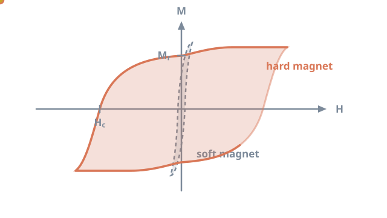
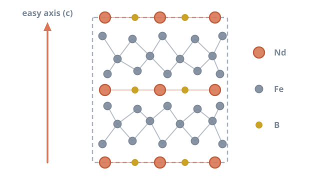

# NdFeB magnets: the small giants behind modern motors

<figure class="post-hero" markdown>

</figure>

Every electric car, wind turbine and smartphone vibration motor relies on a
magnet you have probably never seen. It is made of neodymium, iron and boron. Gram for
gram, it is the strongest permanent magnet ever commercialised.

<!-- more -->

## A discovery made twice in one year

In 1984, two teams announced the same breakthrough almost simultaneously. At Sumitomo
Special Metals in Japan, Masato Sagawa and colleagues produced fully dense **sintered**
Nd–Fe–B magnets from pressed powder.[^1] At General Motors in the United States, John
Croat's group made magnets from **rapidly quenched** (melt-spun) ribbons.[^2]

Both routes led to the same compound: Nd2Fe14B. Four decades later,
these two processing families still dominate the industry.[^3]

## What makes a magnet "permanent"?

All ferromagnets can be magnetised. A *permanent* magnet must also **resist being
demagnetised**. Two numbers capture this, and both come from the hysteresis loop.

<figure markdown>

<figcaption>A hard magnet (wide loop) keeps its magnetisation; a soft magnet (narrow loop) loses it easily.</figcaption>
</figure>

- **Remanence (Mr)**: the magnetisation left when the external field is removed.
  This sets how strong the magnet is.
- **Coercivity (Hc)**: the reverse field needed to cancel the magnetisation.
  This sets how stubborn the magnet is.

Together they give the maximum energy product, (BH)max. It measures how much
magnetic energy a magnet can deliver per unit volume. NdFeB has the highest
(BH)max of any commercial magnet, so designers can use less material for the
same field.[^3][^5]

## Inside the crystal

Nd2Fe14B has a tetragonal structure with 68 atoms in each unit
cell.[^4] Each element has a job.

<figure markdown>

<figcaption>Simplified side view of Nd2Fe14B. Iron supplies the magnetisation; neodymium locks it along the c axis.</figcaption>
</figure>

- **Iron** carries most of the magnetic moment. This gives a high saturation
  polarisation of about 1.6 T.[^4]
- **Neodymium** provides strong magnetocrystalline anisotropy. The magnetisation prefers
  one direction, the crystal's c axis, with an anisotropy field of around 7 T.[^4]
- **Boron** stabilises the tetragonal structure.

Strong anisotropy is the key ingredient. It is what lets a magnet hold its direction when
pushed by an opposing field.

## The coercivity gap

In theory, the anisotropy field sets the upper limit for coercivity. In practice, real
magnets reach only a fraction of it.[^6] Reversal does not happen everywhere at once.
It starts at weak spots, such as defective grain surfaces or magnetically coupled
neighbouring grains, and then spreads.

So coercivity is a **microstructure** property, not just a chemistry property. Three
levers matter most:[^6][^5]

1. **Grain size.** Smaller grains reduce the number of easy nucleation sites.
2. **Grain boundaries.** A thin, non-magnetic boundary layer decouples neighbouring grains.
3. **Heavy rare earths.** Adding dysprosium raises anisotropy and coercivity. However,
   dysprosium is scarce and costly, so reducing it is a major research goal.

Temperature adds a further challenge. The Curie temperature of
Nd2Fe14B is only about 585 K (312 °C).[^4] Coercivity falls quickly
as a motor heats up, so high-temperature applications need extra margin.[^3]

## Processing shapes performance

Because microstructure controls coercivity, the processing route is central. Conventional
sintering presses aligned powder and heats it until dense. **Spark plasma sintering
(SPS)** instead passes a pulsed electric current through the powder under pressure.[^7]
It reaches full density in minutes rather than hours. This limits grain growth, which
helps preserve the fine grains that coercivity depends on.

## My work

At The University of Queensland, I am developing an NdFeB based magnet, from design
through to a working prototype. My focus is how the processing route and composition
change the final magnetic performance. I use powder metallurgy and spark plasma sintering
to control the microstructure.

!!! tip "The big picture"
    Demand for NdFeB is rising with electric transport and renewable energy.[^3][^5]
    Magnets that need fewer critical elements, and that keep their coercivity when hot,
    will help that transition scale.

[Back to my research](../../research.md#ndfeb){ .md-button }

## References

[^1]: Sagawa, M., Fujimura, S., Togawa, N., Yamamoto, H., & Matsuura, Y. (1984). New material for permanent magnets on a base of Nd and Fe. *Journal of Applied Physics*, 55, 2083–2087. [doi:10.1063/1.333572](https://doi.org/10.1063/1.333572)
[^2]: Croat, J. J., Herbst, J. F., Lee, R. W., & Pinkerton, F. E. (1984). Pr-Fe and Nd-Fe-based materials: A new class of high-performance permanent magnets. *Journal of Applied Physics*, 55, 2078–2082. [doi:10.1063/1.333571](https://doi.org/10.1063/1.333571)
[^3]: Gutfleisch, O., Willard, M. A., Brück, E., Chen, C. H., Sankar, S. G., & Liu, J. P. (2011). Magnetic materials and devices for the 21st century: Stronger, lighter, and more energy efficient. *Advanced Materials*, 23, 821–842. [doi:10.1002/adma.201002180](https://doi.org/10.1002/adma.201002180)
[^4]: Herbst, J. F. (1991). R2Fe14B materials: Intrinsic properties and technological aspects. *Reviews of Modern Physics*, 63, 819–898. [doi:10.1103/RevModPhys.63.819](https://doi.org/10.1103/RevModPhys.63.819)
[^5]: Coey, J. M. D. (2020). Perspective and prospects for rare earth permanent magnets. *Engineering*, 6, 119–131. [doi:10.1016/j.eng.2018.11.034](https://doi.org/10.1016/j.eng.2018.11.034)
[^6]: Hono, K., & Sepehri-Amin, H. (2012). Strategy for high-coercivity Nd–Fe–B magnets. *Scripta Materialia*, 67, 530–535. [doi:10.1016/j.scriptamat.2012.06.038](https://doi.org/10.1016/j.scriptamat.2012.06.038)
[^7]: Munir, Z. A., Anselmi-Tamburini, U., & Ohyanagi, M. (2006). The effect of electric field and pressure on the synthesis and consolidation of materials: A review of the spark plasma sintering method. *Journal of Materials Science*, 41, 763–777. [doi:10.1007/s10853-006-6555-2](https://doi.org/10.1007/s10853-006-6555-2)
