# NdFeB magnets: the small giants behind modern motors

<figure class="post-hero" markdown>

</figure>

Every electric car, wind turbine and smartphone vibration motor relies on a
magnet you have probably never seen. It is made of neodymium, iron and boron. Gram for
gram, it is the strongest permanent magnet ever commercialised.

<!-- more -->

## A discovery made twice in one year

In 1984, two teams announced the same breakthrough almost simultaneously. At Sumitomo
Special Metals in Japan, Masato Sagawa and colleagues produced fully dense **sintered**
Nd–Fe–B magnets from pressed powder.[^sagawa] At General Motors in the United States,
John Croat's group made magnets from **rapidly quenched** (melt-spun) ribbons.[^croat]

Both routes led to the same compound: Nd2Fe14B. Four decades later,
these two processing families still dominate the industry.[^gutfleisch]

## What makes a magnet "permanent"?

All ferromagnets can be magnetised. A *permanent* magnet must also **resist being
demagnetised**. Two numbers capture this, and both come from the hysteresis loop.

<figure markdown>

<figcaption>A hard magnet (wide loop) keeps its magnetisation; a soft magnet (narrow loop) loses it easily.</figcaption>
</figure>

- **Remanence (Mr)**: the magnetisation left when the external field is removed.
  This sets how strong the magnet is.
- **Coercivity (Hc)**: the reverse field needed to cancel the magnetisation.
  This sets how stubborn the magnet is.

Together they give the maximum energy product, (BH)max. It measures how much
magnetic energy a magnet can deliver per unit volume. NdFeB has the highest
(BH)max of any commercial magnet, so designers can use less material for the
same field.[^gutfleisch][^coey]

## Inside the crystal

Nd2Fe14B has a tetragonal structure with 68 atoms in each unit
cell.[^herbst] Each element has a job.

<figure markdown>

<figcaption>Simplified side view of Nd2Fe14B. Iron supplies the magnetisation; neodymium locks it along the c axis.</figcaption>
</figure>

| Property of Nd2Fe14B | Typical value | Why it matters |
| --- | --- | --- |
| Saturation polarisation, Js | about 1.6 T | Upper limit for remanence |
| Anisotropy field, μ0HA | around 7 T | Theoretical ceiling for coercivity |
| Curie temperature, TC | about 585 K (312 °C) | Magnetism vanishes above this |

Intrinsic values at room temperature.[^herbst]
{ .table-note }

- **Iron** carries most of the magnetic moment.
- **Neodymium** provides strong magnetocrystalline anisotropy. The magnetisation prefers
  one direction, the crystal's c axis.
- **Boron** stabilises the tetragonal structure.

## The coercivity gap

In theory, the anisotropy field sets the upper limit for coercivity. In practice, real
magnets reach only a fraction of it.[^hono] Reversal does not happen everywhere at once.
It starts at weak spots, such as defective grain surfaces or magnetically coupled
neighbouring grains, and then spreads.

So coercivity is a **microstructure** property, not just a chemistry property. Three
levers matter most:[^hono][^coey]

1. **Grain size.** Smaller grains reduce the number of easy nucleation sites.
2. **Grain boundaries.** A thin, non-magnetic boundary layer decouples neighbouring grains.
3. **Heavy rare earths.** Adding dysprosium or terbium raises anisotropy and coercivity.
   However, these elements are scarce and costly.

A widely adopted compromise is **grain boundary diffusion**. Dysprosium or terbium is
applied to the surface of a finished magnet and diffused along the grain boundaries by
heat treatment. It ends up concentrated in the outer shell of each grain, exactly where
reversal begins. This raises coercivity while using far less heavy rare earth than adding
it to the whole alloy.[^kim]

Temperature adds a further challenge. Coercivity falls quickly as a motor heats up, so
high-temperature applications such as traction motors need extra margin.[^gutfleisch]

## Three ways to make an NdFeB magnet

Industry makes NdFeB magnets by three main routes. They trade performance against
shape freedom and cost.[^brown][^croat]

| Route | How it is made | Strengths | Typical uses |
| --- | --- | --- | --- |
| **Sintered** | Fine powder aligned in a field, pressed and sintered to full density | Highest (BH)max; fully dense and anisotropic | EV and wind-turbine motors, industrial drives |
| **Bonded** | Melt-spun flakes mixed with a polymer, then moulded or pressed | Complex net shapes, tight tolerances; lower energy product | Small motors, sensors, electronics |
| **Hot-deformed** | Melt-spun powder hot-pressed, then die-upset to create alignment | Very fine grains, so good coercivity with little heavy rare earth | Rings and arc segments for motors |

Sintered magnets account for most of the market by value, because they deliver the
strongest fields.[^gutfleisch]

## The conventional sintered route, step by step

<figure class="figure-wide" markdown>
{ target=_blank title="Open full size" }
<figcaption>The conventional powder-metallurgy route for sintered NdFeB magnets.</figcaption>
</figure>

Each step is designed to protect a fine, well-aligned microstructure.[^brown][^sagawa]

1. **Melting and strip casting.** The alloy is melted under vacuum and poured onto a
   rotating, water-cooled copper wheel. Rapid cooling gives thin flakes with a fine,
   uniform structure and little free iron.
2. **Hydrogen decrepitation.** The flakes absorb hydrogen. The grain boundary phase
   expands and the flakes crack into a coarse, friable powder.
3. **Jet milling.** Streams of inert gas collide the particles until they are a few
   micrometres across. Ideally, each particle is a single crystal.
4. **Alignment and pressing.** The powder is placed in a strong magnetic field. Each
   particle rotates so its easy axis points the same way. The powder is then pressed,
   locking the alignment in place.
5. **Vacuum sintering.** The pressed compact is heated to roughly 1,000 to 1,100 °C. A
   neodymium-rich liquid forms at the grain boundaries and pulls the part to full density.
6. **Post-sinter annealing.** A lower-temperature heat treatment optimises the grain
   boundary phase and raises coercivity.
7. **Machining.** Sintered blocks are hard and brittle. They are ground, sliced and
   wire-cut to final shape.
8. **Coating.** NdFeB corrodes easily, so magnets are plated (often nickel-copper-nickel)
   or coated with epoxy.
9. **Magnetising.** Finally, a short, intense pulsed field magnetises the part to
   saturation.

Oxygen is the enemy throughout. The fine powder oxidises rapidly, and oxides consume
neodymium that should be at the grain boundaries. Modern plants therefore handle powder
under inert gas from milling to sintering.[^brown]

## See it made

<iframe src="https://www.youtube-nocookie.com/embed/vXqOcZDNSfg" title="Rare Earth Magnets: HOW they're made (MP Materials)" loading="lazy" allow="accelerometer; encrypted-media; gyroscope; picture-in-picture" allowfullscreen></iframe>

MP Materials, which mines rare earths at Mountain Pass, California, explains how rare earth magnets are made.

<iframe src="https://www.youtube-nocookie.com/embed/5JaXVbXPcvY" title="Manufacturing processes for sintered NdFeB magnet (X-Mag)" loading="lazy" allow="accelerometer; encrypted-media; gyroscope; picture-in-picture" allowfullscreen></iframe>

Manufacturing processes for sintered NdFeB magnets, from magnet maker X-Mag.

## Who makes NdFeB magnets?

Production is highly concentrated. The International Energy Agency estimates that China
produced about 94% of the world's sintered permanent magnets in 2024.[^iea] Outside China,
long-established producers include TDK, Shin-Etsu Chemical and Proterial (formerly
Hitachi Metals) in Japan, and VAC (Vacuumschmelze) in Germany.[^magmag]

## Processing shapes performance

Because microstructure controls coercivity, the processing route is central. Conventional
sintering needs hours at high temperature, which lets grains grow. **Spark plasma
sintering (SPS)** instead passes a pulsed electric current through the powder under
pressure.[^munir] It reaches full density in minutes. This limits grain growth, helping
preserve the fine grains that coercivity depends on.

## My work

At The University of Queensland, I am developing an NdFeB based magnet, from design
through to a working prototype. My focus is how the processing route and composition
change the final magnetic performance. I use powder metallurgy and spark plasma sintering
to control the microstructure.

!!! tip "The big picture"
    Demand for NdFeB is rising with electric transport and renewable energy.[^gutfleisch][^coey]
    Magnets that need fewer critical elements, and that keep their coercivity when hot,
    will help that transition scale.

[Back to my research](../../research.md#ndfeb){ .md-button }

## References

[^sagawa]: Sagawa, M., Fujimura, S., Togawa, N., Yamamoto, H., & Matsuura, Y. (1984). New material for permanent magnets on a base of Nd and Fe. *Journal of Applied Physics*, 55, 2083–2087. [doi:10.1063/1.333572](https://doi.org/10.1063/1.333572)
[^croat]: Croat, J. J., Herbst, J. F., Lee, R. W., & Pinkerton, F. E. (1984). Pr-Fe and Nd-Fe-based materials: A new class of high-performance permanent magnets. *Journal of Applied Physics*, 55, 2078–2082. [doi:10.1063/1.333571](https://doi.org/10.1063/1.333571)
[^gutfleisch]: Gutfleisch, O., Willard, M. A., Brück, E., Chen, C. H., Sankar, S. G., & Liu, J. P. (2011). Magnetic materials and devices for the 21st century: Stronger, lighter, and more energy efficient. *Advanced Materials*, 23, 821–842. [doi:10.1002/adma.201002180](https://doi.org/10.1002/adma.201002180)
[^coey]: Coey, J. M. D. (2020). Perspective and prospects for rare earth permanent magnets. *Engineering*, 6, 119–131. [doi:10.1016/j.eng.2018.11.034](https://doi.org/10.1016/j.eng.2018.11.034)
[^herbst]: Herbst, J. F. (1991). R2Fe14B materials: Intrinsic properties and technological aspects. *Reviews of Modern Physics*, 63, 819–898. [doi:10.1103/RevModPhys.63.819](https://doi.org/10.1103/RevModPhys.63.819)
[^hono]: Hono, K., & Sepehri-Amin, H. (2012). Strategy for high-coercivity Nd–Fe–B magnets. *Scripta Materialia*, 67, 530–535. [doi:10.1016/j.scriptamat.2012.06.038](https://doi.org/10.1016/j.scriptamat.2012.06.038)
[^kim]: Kim, T.-H., Sasaki, T. T., Ohkubo, T., Takada, Y., Kato, A., Kaneko, Y., & Hono, K. (2019). Microstructure and coercivity of grain boundary diffusion processed Dy-free and Dy-containing Nd-Fe-B sintered magnets. *Acta Materialia*, 172, 139–149. [doi:10.1016/j.actamat.2019.04.032](https://doi.org/10.1016/j.actamat.2019.04.032)
[^brown]: Brown, D., Ma, B.-M., & Chen, Z. (2002). Developments in the processing and properties of NdFeB-type permanent magnets. *Journal of Magnetism and Magnetic Materials*, 248, 432–440. [doi:10.1016/S0304-8853(02)00334-7](https://doi.org/10.1016/S0304-8853(02)00334-7)
[^iea]: Skillings Mining Review (2026, September 14). *Rare earths supply chain 2026: Magnet capacity reaches 300,000 tonnes*, reporting International Energy Agency estimates. [skillings.net](https://www.skillings.net/?p=101182)
[^magmag]: Magnetics Magazine (2018, December 10). *Production of rare earth magnets soars in China, says new market report*. [magneticsmag.com](https://magneticsmag.com/production-of-rare-earth-magnets-soars-in-china-says-new-market-report/)
[^munir]: Munir, Z. A., Anselmi-Tamburini, U., & Ohyanagi, M. (2006). The effect of electric field and pressure on the synthesis and consolidation of materials: A review of the spark plasma sintering method. *Journal of Materials Science*, 41, 763–777. [doi:10.1007/s10853-006-6555-2](https://doi.org/10.1007/s10853-006-6555-2)
