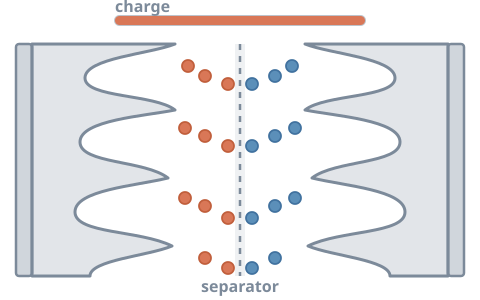
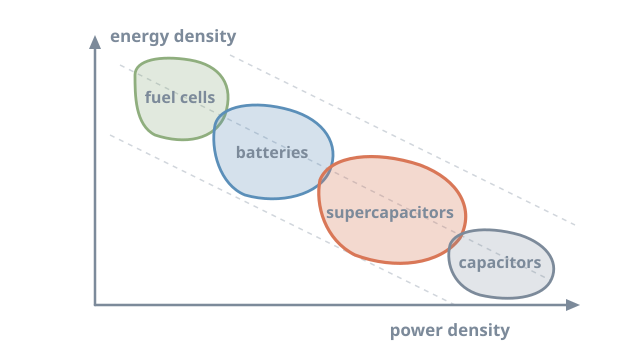
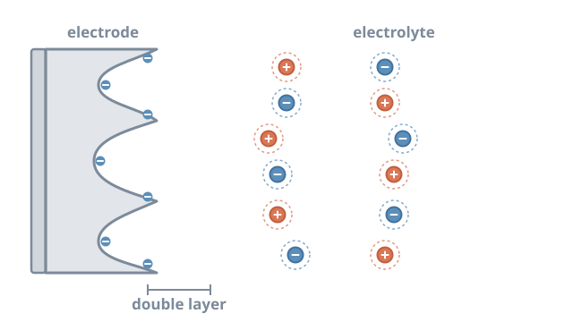

# Supercapacitors: storing energy at the surface

<figure class="post-hero" markdown>

</figure>

Batteries store a lot of energy but release it slowly. Capacitors release
energy almost instantly but hold very little. Supercapacitors sit in between. They charge
in seconds and survive a very large number of cycles. The secret lies in surfaces, pores
and a layer of ions just a few atoms thick.

<!-- more -->

## Where supercapacitors fit

Energy storage devices are often compared on a Ragone plot. It shows how much energy a
device stores against how quickly it can deliver that energy.[^1]

<figure markdown>

<figcaption>Supercapacitors bridge the gap between conventional capacitors and batteries.</figcaption>
</figure>

Supercapacitors deliver high power and long cycle life. That suits regenerative braking,
backup power and grid stabilisation, where bursts of energy matter more than duration.[^1]

## Charge stored in a double layer

When a voltage is applied, ions in the electrolyte move toward the oppositely charged
electrode. They form a compact layer at the surface, called the **electric double
layer**. Charge is stored electrostatically, with no chemical reaction.[^2]

<figure markdown>

<figcaption>During charging, ions line up at the electrode surface; during discharge they drift back.</figcaption>
</figure>

The capacitance follows the familiar parallel-plate relation

$$
C = \frac{\varepsilon_r \varepsilon_0 A}{d}
$$

where *A* is the electrode surface area and *d* is the tiny charge separation. Because
*d* is so small, the capacitance per unit area is large. So the goal is to maximise
*A*, using porous carbons with enormous internal surface area.[^1][^2]

The stored energy is

$$
E = \tfrac{1}{2} C V^2
$$

so both capacitance and operating voltage *V* matter.

## Pores and graphene

Surface area alone is not the full story. Chmiola and colleagues showed that carbon pores
smaller than 1 nm give an unexpected rise in capacitance.[^3] Ions partly shed their
solvent shells to enter such pores, bringing charges closer together.

Graphene, a single layer of carbon atoms, is attractive because both of its faces are
exposed. Its theoretical surface area is about 2,630 m2/g.[^4] In practice,
graphene sheets tend to restack, which hides much of that surface.

## A second mechanism: pseudocapacitance

Some materials add fast, reversible redox reactions at or near their surface. This is
called **pseudocapacitance**. Metal oxides and hydroxides, such as MnO2 and
Ni(OH)2, can store considerably more charge this way than carbon alone.[^5][^6]
The trade-off is that they often conduct electrons poorly and can be less stable over
many cycles.

## Hybrid electrodes

A natural idea is to combine both mechanisms. Conductive graphene provides surface area
and electron pathways. Metal oxides and hydroxides add pseudocapacitance. The graphene
also helps keep the oxide particles from aggregating.[^6]

## My work

For my MSc at the Bangladesh University of Engineering and Technology, I developed a
ternary hybrid electrode. It combined reduced graphene oxide (rGO) with
Ni(OH)2 and MnO2.[^7] The material formed a wrinkled, flower-like
structure that improved charge storage. I have since applied machine learning to carbon
supercapacitor design; see my [Machine Learning](../../machine-learning.md) page.

!!! tip "The big picture"
    Supercapacitors will not replace batteries. They complement them, handling the fast,
    high-power jobs that batteries do poorly. Better electrode materials can extend their
    energy density while keeping their speed.

[Back to my research](../../research.md#supercapacitor){ .md-button }

## References

[^1]: Simon, P., & Gogotsi, Y. (2008). Materials for electrochemical capacitors. *Nature Materials*, 7, 845–854. [doi:10.1038/nmat2297](https://doi.org/10.1038/nmat2297)
[^2]: Conway, B. E. (1999). *Electrochemical Supercapacitors: Scientific Fundamentals and Technological Applications*. Springer. [doi:10.1007/978-1-4757-3058-6](https://doi.org/10.1007/978-1-4757-3058-6)
[^3]: Chmiola, J., Yushin, G., Gogotsi, Y., Portet, C., Simon, P., & Taberna, P. L. (2006). Anomalous increase in carbon capacitance at pore sizes less than 1 nanometer. *Science*, 313, 1760–1763. [doi:10.1126/science.1132195](https://doi.org/10.1126/science.1132195)
[^4]: Stoller, M. D., Park, S., Zhu, Y., An, J., & Ruoff, R. S. (2008). Graphene-based ultracapacitors. *Nano Letters*, 8, 3498–3502. [doi:10.1021/nl802558y](https://doi.org/10.1021/nl802558y)
[^5]: Augustyn, V., Simon, P., & Dunn, B. (2014). Pseudocapacitive oxide materials for high-rate electrochemical energy storage. *Energy & Environmental Science*, 7, 1597–1614. [doi:10.1039/c3ee44164d](https://doi.org/10.1039/c3ee44164d)
[^6]: Wang, G., Zhang, L., & Zhang, J. (2012). A review of electrode materials for electrochemical supercapacitors. *Chemical Society Reviews*, 41, 797–828. [doi:10.1039/c1cs15060j](https://doi.org/10.1039/c1cs15060j)
[^7]: Tarek, Y. A., Shakil, R., Reaz, A. H., Roy, C. K., Barai, H. R., & Firoz, S. H. (2022). Wrinkled flower-like rGO intercalated with Ni(OH)2 and MnO2 as high-performing supercapacitor electrode. *ACS Omega*, 7(23), 20145–20154. [doi:10.1021/acsomega.2c01986](https://doi.org/10.1021/acsomega.2c01986)
