# Supercapacitors: storing energy at the surface

<figure class="post-hero" markdown>

</figure>

Batteries store a lot of energy but release it slowly. Capacitors release
energy almost instantly but hold very little. Supercapacitors sit in between. They charge
in seconds and survive a very large number of cycles. The secret lies in surfaces, pores
and a layer of ions just a few atoms thick.

<!-- more -->

## Where supercapacitors fit

Energy storage devices are often compared on a Ragone plot. It shows how much energy a
device stores against how quickly it can deliver that energy.[^simon]

<figure markdown>

<figcaption>Supercapacitors bridge the gap between conventional capacitors and batteries.</figcaption>
</figure>

| | Supercapacitor (EDLC) | Lithium-ion battery |
| --- | --- | --- |
| Storage mechanism | Ions adsorb at surfaces (physical) | Ions enter the electrode bulk (chemical) |
| Charge time | Seconds | Tens of minutes to hours |
| Cycle life | Hundreds of thousands of cycles or more | Typically thousands of cycles |
| Energy density | Low | High |
| Power density | Very high | Moderate |

Qualitative comparison based on Simon and Gogotsi[^simon] and Burke.[^burke]

Supercapacitors suit regenerative braking, backup power, cranes, wind-turbine pitch
control and grid stabilisation, where bursts of energy matter more than duration.[^simon][^burke]

## Charge stored in a double layer

When a voltage is applied, ions in the electrolyte move toward the oppositely charged
electrode. They form a compact layer at the surface, called the **electric double
layer**. Charge is stored electrostatically, with no chemical reaction.[^conway]

<figure markdown>

<figcaption>During charging, ions line up at the electrode surface; during discharge they drift back.</figcaption>
</figure>

The capacitance follows the familiar parallel-plate relation

$$
C = \frac{\varepsilon_r \varepsilon_0 A}{d}
$$

where *A* is the electrode surface area and *d* is the tiny charge separation. Because
*d* is so small, the capacitance per unit area is large. So the goal is to maximise
*A*, using porous carbons with enormous internal surface area.[^simon][^conway]

The stored energy is

$$
E = \tfrac{1}{2} C V^2
$$

so both capacitance and operating voltage *V* matter. Voltage is limited by the
electrolyte. Water decomposes above about 1.2 V, so commercial cells mostly use organic
electrolytes, which allow around 2.7 V per cell.[^simon]

## Anatomy of a commercial cell

A typical cylindrical supercapacitor contains:[^burke]

- **Two carbon electrodes**, each a thin coating of activated carbon on aluminium foil.
  The foil acts as the current collector.
- **A porous separator** between them, which lets ions through but prevents short circuits.
- **An organic electrolyte**, a salt dissolved in a solvent such as acetonitrile.
- **A sealed aluminium can**, with terminals connected to the foils.

Activated carbon is the workhorse electrode material. It is made by carbonising a
precursor, such as coconut shell, then "activating" it to open up a network of pores.
This gives surface areas of roughly 1,000 to 2,000 m2 per gram.[^simon]

## How supercapacitors are made

<figure class="figure-wide" markdown>
{ target=_blank title="Open full size" }
<figcaption>The conventional manufacturing route for wound supercapacitor cells.</figcaption>
</figure>

The process borrows heavily from lithium-ion battery manufacturing:[^burke]

1. **Activated carbon production.** A biomass precursor is carbonised, then activated with
   steam or chemicals to create pores.
2. **Slurry mixing.** Activated carbon is mixed with a conductive carbon additive and a
   polymer binder.
3. **Electrode coating.** The slurry is coated evenly onto aluminium foil.
4. **Drying and calendering.** The coating is dried, then pressed between rollers to
   control thickness and density.
5. **Slitting.** The wide electrode roll is cut into narrow strips.
6. **Winding.** Two electrode strips and two separator layers are wound into a
   "jelly roll".
7. **Electrolyte filling and sealing.** The roll is placed in a can, dried thoroughly,
   filled with electrolyte and sealed. Moisture must be kept out, because water limits
   the voltage and shortens life.
8. **Formation and testing.** Each cell is conditioned, then tested for capacitance,
   internal resistance and leakage current.

<iframe src="https://www.youtube-nocookie.com/embed/1wuiue5OpUw" title="Automatic winding machine for supercapacitor manufacturing (TOB New Energy)" loading="lazy" allow="accelerometer; encrypted-media; gyroscope; picture-in-picture" allowfullscreen></iframe>

Step 6 in action: an automatic winding machine for cylindrical supercapacitor cells (TOB New Energy).

<iframe src="https://www.youtube-nocookie.com/embed/-7T-6XdiRTw" title="Supercapacitors explained (Undecided with Matt Ferrell)" loading="lazy" allow="accelerometer; encrypted-media; gyroscope; picture-in-picture" allowfullscreen></iframe>

A general-audience explainer on supercapacitors and their applications (Undecided with Matt Ferrell).

## Who makes supercapacitors?

Major manufacturers include Maxwell Technologies (United States), Eaton, Nippon
Chemi-Con (Japan), LS Materials (South Korea) and CAP-XX (Australia).[^market] Skeleton
Technologies, founded in Estonia, makes its own carbon from curved, atom-thin sheets and
has installed manufacturing in Germany.[^eib]

## Pores and graphene

Surface area alone is not the full story. Chmiola and colleagues showed that carbon pores
smaller than 1 nm give an unexpected rise in capacitance.[^chmiola] Ions partly shed
their solvent shells to enter such pores, bringing charges closer together.

Graphene, a single layer of carbon atoms, is attractive because both of its faces are
exposed. Its theoretical surface area is about 2,630 m2/g.[^stoller] In
practice, graphene sheets tend to restack, which hides much of that surface.

## A second mechanism: pseudocapacitance

Some materials add fast, reversible redox reactions at or near their surface. This is
called **pseudocapacitance**. Metal oxides and hydroxides, such as MnO2 and
Ni(OH)2, can store considerably more charge this way than carbon
alone.[^augustyn][^wang] The trade-off is that they often conduct electrons poorly and
can be less stable over many cycles.

## Hybrid electrodes

A natural idea is to combine both mechanisms. Conductive graphene provides surface area
and electron pathways. Metal oxides and hydroxides add pseudocapacitance. The graphene
also helps keep the oxide particles from aggregating.[^wang]

## My work

For my MSc at the Bangladesh University of Engineering and Technology, I developed a
ternary hybrid electrode. It combined reduced graphene oxide (rGO) with
Ni(OH)2 and MnO2.[^tarek] The material formed a wrinkled,
flower-like structure that improved charge storage. I have since applied machine learning
to carbon supercapacitor design; see my [Machine Learning](../../machine-learning.md)
page.

!!! tip "The big picture"
    Supercapacitors will not replace batteries. They complement them, handling the fast,
    high-power jobs that batteries do poorly. Better electrode materials can extend their
    energy density while keeping their speed.

[Back to my research](../../research.md#supercapacitor){ .md-button }

## References

[^simon]: Simon, P., & Gogotsi, Y. (2008). Materials for electrochemical capacitors. *Nature Materials*, 7, 845–854. [doi:10.1038/nmat2297](https://doi.org/10.1038/nmat2297)
[^burke]: Burke, A. (2000). Ultracapacitors: Why, how, and where is the technology. *Journal of Power Sources*, 91, 37–50. [doi:10.1016/S0378-7753(00)00485-7](https://doi.org/10.1016/S0378-7753(00)00485-7)
[^conway]: Conway, B. E. (1999). *Electrochemical Supercapacitors: Scientific Fundamentals and Technological Applications*. Springer. [doi:10.1007/978-1-4757-3058-6](https://doi.org/10.1007/978-1-4757-3058-6)
[^market]: MarketsandMarkets. *Supercapacitor market: Research insight*. [marketsandmarkets.com](https://marketsandmarkets.com/ResearchInsight/supercapacitor-market.asp)
[^eib]: European Investment Bank. *Supercapacitors and coconuts*. [eib.org](https://www.eib.org/en/stories/supercapacitors-and-coconuts)
[^chmiola]: Chmiola, J., Yushin, G., Gogotsi, Y., Portet, C., Simon, P., & Taberna, P. L. (2006). Anomalous increase in carbon capacitance at pore sizes less than 1 nanometer. *Science*, 313, 1760–1763. [doi:10.1126/science.1132195](https://doi.org/10.1126/science.1132195)
[^stoller]: Stoller, M. D., Park, S., Zhu, Y., An, J., & Ruoff, R. S. (2008). Graphene-based ultracapacitors. *Nano Letters*, 8, 3498–3502. [doi:10.1021/nl802558y](https://doi.org/10.1021/nl802558y)
[^augustyn]: Augustyn, V., Simon, P., & Dunn, B. (2014). Pseudocapacitive oxide materials for high-rate electrochemical energy storage. *Energy & Environmental Science*, 7, 1597–1614. [doi:10.1039/c3ee44164d](https://doi.org/10.1039/c3ee44164d)
[^wang]: Wang, G., Zhang, L., & Zhang, J. (2012). A review of electrode materials for electrochemical supercapacitors. *Chemical Society Reviews*, 41, 797–828. [doi:10.1039/c1cs15060j](https://doi.org/10.1039/c1cs15060j)
[^tarek]: Tarek, Y. A., Shakil, R., Reaz, A. H., Roy, C. K., Barai, H. R., & Firoz, S. H. (2022). Wrinkled flower-like rGO intercalated with Ni(OH)2 and MnO2 as high-performing supercapacitor electrode. *ACS Omega*, 7(23), 20145–20154. [doi:10.1021/acsomega.2c01986](https://doi.org/10.1021/acsomega.2c01986)
