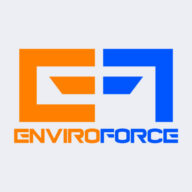
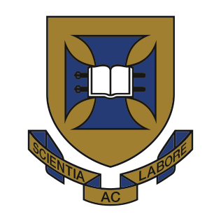
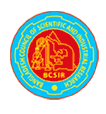
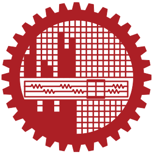
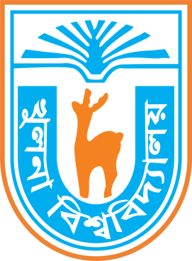

---
hide:
  - navigation
  - toc
---

<h1 class="sr-only">Yeasin Tarek</h1>

yeasin@tarek: ~

<pre class="term__ascii" role="img" aria-label="ASCII art portrait of Yeasin Tarek">                           ;:;;-;~~                                             --;:::----;-:                                         ;,-;:,;~;~~+~-:,``                                     :;;;::,;-`,~;~~;,,`,                                   ;;,::;;:;--:::,-~:,:,`                                 :;==***=~--~+ooooa**~:`                                 ;*oaaOOOaaooO000O000o~`                                 -+xoooO0###0#%%#000ao=;                                 -~=oO0##%@%00%%#00Oxx+;                                +;+-:;;-=a00OOx*=*=xo*;=                               -=++;;--;,:-x*-:,-~+=ox=O=                              +-~*=~--=~:-#a*-;;~+*x*=ox                               ++xoO##O*=x%####000Oa*Oo                                 ~*oO##xoxo%%0aa##%#a=a                                  :~*xax-;:=Oa*o=~oOo*~                                    ;;+-:,;:;-*+++;;=+=:                                    ;-+-;,;==*=~++:-=~-                                      :-+*==*oaaaOa~=-;                                       +;:+o=~~-*aO*+;-=                                       O+;;=xxxoao*~;+ox0-                                   -+0a=~~+++++++=oaoO0=-                               ;--~+000a*====**xooa000=~---;                      ;;--~~~+++a0000ax==*xxo0000O=++~~~--;;                  -~~++++===x00000OaxxoO00000o===++++~~~                    ++======xO00ax******oaO00x=======+                        ===****oox*****=*xox*xo****===                              **********==**********                                       *****==*****                      </pre>

yeasin@tarek

OSMaterials Science, Chemistry

HostThe University of Queensland

RoleSenior Research Assistant

AlsoAssistant Scientist, EnviroForce

LocationBrisbane, Australia

UptimePhD 2022 to 2026 · MSc · BSc

Research.NowNdFeB magnets, HEA superconductors

Research.PhDMgB₂ joints for MRI magnets

Research.MScHybrid supercapacitor electrodes

Tools.LabArc melting, SPS, XRD, SEM, TEM, FIB

Tools.CodePython, machine learning

Contact

Email<a href="mailto:m.tarek@uq.edu.au">m.tarek@uq.edu.au</a>

LinkedIn<a href="https://www.linkedin.com/in/yatarek/">yatarek</a>

GitHub<a href="https://github.com/YATAREK">YATAREK</a>

ORCID<a href="https://orcid.org/0000-0003-2113-2486">0000-0003-2113-2486</a>

Stats

Publications<a href="publications/">10</a>|Blog posts<a href="blog/">4</a>

Research projects<a href="research/">4</a>|ML tools<a href="machine-learning/">3</a>

yeasin@tarek:~$ 

[Read my research](research.md){ .md-button .md-button--primary }
[View publications](publications.md){ .md-button }

---

## Experience

#### Assistant Scientist · EnviroForce

Oct 2026 – Present · Brisbane, Australia

- LC-MS analysis of illicit drug residues and environmental contaminants.
- NATA accreditation, GLP compliance and quality assurance.
- NATA-accredited sampling for methamphetamine, mould, lead and asbestos.

#### Senior Research Assistant · The University of Queensland

Sep 2026 – Present · Brisbane, Australia

- Developing NdFeB permanent magnets, from design to working prototype.
- Developing ductile high-entropy superconductors for fusion applications.
- Applying AI and machine learning to superconducting and high-entropy materials.
- Linking processing and composition to material properties.

#### Doctoral Researcher · The University of Queensland

Oct 2022 – Sep 2026 · Brisbane, Australia

- Developed a joining method for reacted MgB2 in persistent-mode MRI magnets.
- Synthesised samples by arc melting and spark plasma sintering, with inert-atmosphere heat treatment.
- Characterised microstructure by XRD, SEM, TEM and FIB.
- Measured magnetic and transport properties at cryogenic temperatures.
- Analysed flux pinning and critical current density (Jc) under applied field.
- Quantified wire filling factor and porosity by image segmentation.
- Built experimental components in the in-house machine shop.
- Managed laboratory equipment, procurement and safety under GLP.

#### Researcher · Bangladesh Council of Scientific and Industrial Research

Aug 2021 – Aug 2022 · Dhaka, Bangladesh

- Applied research in water treatment and desalination.
- Testing, data analysis and reporting in an ISO-accredited laboratory.
- Sampling, troubleshooting and technical support for government agencies.

#### Postgraduate Researcher · BUET

Mar 2021 – Jul 2021 · Dhaka, Bangladesh

- Developed biomass-derived electrodes for Na⁺/K⁺-ion batteries.
- Set up electrochemical testing and evaluated battery performance.
- Managed procurement and wrote project documentation and SOPs.

#### Experimental Officer · BUET

Aug 2020 – Dec 2020 · Dhaka, Bangladesh

- Set up the laboratory for a textile industry project.
- Analysed industrial sludge and effluents by GC-MS, FTIR and TXRF.
- Coordinated with industry stakeholders and helped organise a symposium.

## Education

#### Doctor of Philosophy, Mechanical Engineering · The University of Queensland

Oct 2022 – Sep 2026

#### Master of Science, Chemistry · Bangladesh University of Engineering and Technology

Nov 2018 – Jun 2021

#### Bachelor of Science, Chemistry · Khulna University

Jun 2014 – Jun 2018

## Get in touch

Open to collaborations and research discussions. [Contact me](contact.md).
