---
hide:
  - toc
---

# Machine Learning for Materials Discovery

Materials discovery has entered a data-driven era. Synthesising novel compounds by trial and error takes months in the laboratory. Chemical space is vast. In contrast, computational screening evaluates thousands of formulations in seconds.

Machine learning enables this acceleration. By converting chemical formulae into composition-based physical descriptors[^ward][^matminer], statistical models capture complex structure-property relationships. These descriptors summarise properties such as atomic radii, electronegativities, valence electron counts and melting temperatures. They require no expensive quantum mechanical calculations.

Here I present three interactive tools that I built for functional materials discovery. The first two target high-entropy alloy superconductors. The third focuses on porous carbon supercapacitor electrodes. Each tool combines predictive modelling with physical constraints to guide laboratory synthesis.

---

## High-Entropy Superconductor Tc Prediction

<figure markdown>
  
  <figcaption>Two-stage machine learning pipeline coupling phase stability classification with critical temperature regression.</figcaption>
</figure>

### Why the Problem Matters
High-entropy alloys (HEAs) mix 4 to 6 principal metallic elements in near-equimolar proportions[^yeh]. This composition strategy creates vast combinatorial spaces with unexpected functional behaviours. In 2014, Koželj and co-workers reported the first superconducting HEA: Ta-Nb-Hf-Zr-Ti[^kozelj]. It forms a body-centred cubic (BCC) solid solution with a superconducting transition temperature (Tc) of about 7.3 K[^kozelj]. Conventional electron-phonon coupling in these alloys follows BCS theory[^bcs]. Empirically, Tc correlates with the valence electron concentration (VEC)[^matthias][^suncava].

Most known superconducting HEAs adopt a single-phase BCC crystal structure, though other phases exist[^suncava]. Identifying new high-entropy superconductors (HES) requires answering two distinct questions. First, will a given mixture of elements form a single-phase solid solution? Second, what is its critical temperature? Most machine learning models predict Tc while ignoring phase formation altogether. Synthesising an alloy that segregates into brittle intermetallics wastes experimental time. I built a two-stage machine learning pipeline that addresses both stability and superconductivity.

### How the Pipeline Works
I split the prediction task into two sequential stages:

1. **Stage 1: Phase stability classifier.** An alloy must first form a stable BCC phase. I trained an Extra Trees classifier[^geurts] on 11,247 experimentally observed HEA compositions compiled by Peivaste et al.[^peivaste]. The model predicts six distinct phase categories: BCC, FCC, BCC+FCC, intermetallic, amorphous, and mixed. It builds upon previous data-driven phase prediction methodologies[^huang]. The model achieves 96% accuracy for BCC identification and 83% accuracy across all six categories.
2. **Stage 2: Critical temperature regression.** Once an alloy passes the BCC phase gate, six regression models predict Tc: Extra Trees, Random Forest, Gradient Boosting, XGBoost, Support Vector Regression (SVR), and K-Nearest Neighbours (KNN). I featurised each alloy using 138 Magpie composition descriptors via the matminer library[^ward][^matminer]. The training set comprises 3,319 superconductors: 3,253 metallic entries from the SuperCon database and 66 high-entropy alloys. This approach builds on earlier machine learning studies on the SuperCon repository[^stanev][^hamidieh].

### Model Performance and Validation
The six regression models perform consistently under cross-validation. Extra Trees and Random Forest delivered the highest accuracy.

| Model | Cross-Validation MAE (K) | Cross-Validation R² |
| :--- | :---: | :---: |
| Extra Trees | 0.84 | 0.87 |
| Random Forest | 0.93 | 0.87 |
| XGBoost | 1.04 | 0.86 |
| K-Nearest Neighbours (KNN) | 1.03 | 0.83 |
| Support Vector Regression (SVR) | 1.21 | 0.81 |
| Gradient Boosting | 1.36 | 0.81 |

Feature importance analysis reveals clear physical drivers. The most important descriptors are the range of elemental melting temperatures and the most common elemental space group. Both relate to interatomic bonding and crystal structure.

As a sanity check, I tested the benchmark NbTaTiZrHf alloy[^kozelj]. My Extra Trees model predicts a Tc of about 6.8 K. This prediction aligns well with the experimental value of about 7.3 K.

### Limits and Operational Bounds
!!! warning "Critical Assumptions and Limitations"
    - **Limited HEA Training Data:** Only 66 of the 3,319 training samples are high-entropy alloys. The remaining samples are conventional binary and ternary metallic superconductors. Predictive accuracy on unexplored HEA families is likely lower than cross-validation metrics indicate.
    - **Extrapolation Overestimation:** Random cross-validation on the SuperCon database overestimates model performance when extrapolating to new chemical classes[^meredig].
    - **Absence of Negative Superconductivity Labels:** The regression models were trained exclusively on known superconductors. The algorithms always return a positive Tc. They cannot recognise when an alloy fails to superconduct. For example, the non-superconducting CoCrFeNiMn Cantor alloy produces a false prediction of about 4.7 K.
    - **Magnetic Element Suppression:** Ferromagnetic and 3d transition elements (Fe, Co, Ni, Mn) break Cooper pairs and strongly suppress superconductivity. Compositions rich in these elements should be interpreted with extreme caution.
    - **Phase Gate Validity Domain:** The Stage 1 phase classifier applies strictly to high-entropy alloys containing 4 to 6 elements, with each element present at 5 to 35 atomic percent.

### How to Use the Tool
Enter any multi-component alloy formula into the web interface. The tool verifies that the formula falls within the 4 to 6 element domain. It runs Stage 1 to estimate <i>P</i>(BCC), then Stage 2 predicts Tc with all six models. Out-of-domain inputs, non-BCC phases and magnetic-element-rich compositions are clearly flagged. The tool shows the selected model's Tc with its ± MAE and the spread across all six models.

[→ Tc Prediction Tool](hes-tc-predictor/index.html){ .md-button }

---

## Inverse Design: HES Compositions for a Target Tc

<figure markdown>
  
  <figcaption>Inverse design screening pipeline evaluating 672 refractory alloy candidates through physical gates.</figcaption>
</figure>

### Why the Problem Matters
Forward regression answers: "What is the Tc of this alloy?" Experimental researchers face the reverse challenge: "Which elemental compositions should I synthesise to reach a target Tc?" Testing candidate mixtures one by one in an arc furnace is slow. Inverse design and active learning systematically screen large compositional libraries to discover optimal candidates[^lookman].

### How the Pipeline Works
I designed an inverse screening workflow tailored to refractory high-entropy alloys:

1. **Candidate Enumeration:** I enumerated all equimolar 4, 5, and 6 element combinations drawn from 10 refractory metals (Nb, Ta, Ti, Zr, Hf, V, Mo, W, Re, Ru). This combinatorial pool yields 672 unique candidate alloys.
2. **Phase Stability Gate:** The Stage 1 Extra Trees classifier screens all 672 formulations. The system retains only candidates with <i>P</i>(BCC) ≥ 0.7. This step eliminates combinations prone to phase separation or multiphase intermetallics.
3. **Multi-Model Tc Prediction:** All six regression models predict Tc independently for each surviving BCC candidate.
4. **5-Check Verification Gate:** To filter out model artefacts, each candidate must pass five heuristic checks:
    - **Phase Stability:** <i>P</i>(BCC) ≥ user threshold (default 0.7).
    - **Cross-Model Agreement:** The standard deviation of the six model predictions is at most 2.0 K.
    - **Physical Bounds:** The ensemble mean Tc falls inside the designated search window.
    - **Valence Electron Count:** The valence electron concentration (VEC) falls in the viable superconducting range of 3.5 to 7.5[^matthias][^suncava].
    - **Novelty:** The composition is not already in the training data (it may still be known in the literature).
5. **Composite Scoring and Ranking:** Surviving alloys are evaluated using a composite objective function. The score balances proximity to the target Tc, phase stability confidence, and inter-model consensus.

The workflow returns the top-ranked candidates that pass every check. Each candidate is scored with the full six-model ensemble, so screening is compute-heavy. On the current free cloud server, each candidate takes about 13 s, so the online tool screens a chosen element pool of up to 20 candidates (about 4 minutes). The full 672-alloy screen is best run offline.

### Experimental Context and Limitations
!!! note "Computational Hypotheses, Not Guaranteed Discoveries"
    Inverse design candidate lists are prioritised hypotheses for laboratory experimentation. They are not guaranteed physical discoveries. The same data and domain limitations described in Section 1 apply directly to these predictions. High predicted Tc values must always be confirmed through vacuum arc melting, phase characterisation via X-ray diffraction, and low-temperature resistivity or magnetometry measurements.

### How to Use the Tool
Choose a target Tc, an element pool and the alloy sizes to screen, then set the acceptance thresholds. The tool shows how many candidates that implies and roughly how long it will take. Results list each composition with its ensemble Tc, model spread, 95% interval, <i>P</i>(BCC), VEC and which checks it passed. Candidates are screened hypotheses, not confirmed superconductors.

[→ Inverse Design Tool](hes-inverse-design/index.html){ .md-button }

---

## Carbon Supercapacitor Inverse Design

<figure markdown>
  
  <figcaption>Physics-informed Gaussian process regression and Bayesian optimisation loop for porous carbon electrodes.</figcaption>
</figure>

### Why the Problem Matters
Electrochemical double-layer capacitors (EDLCs) provide high power density and rapid charge-discharge capability. They store energy electrostatically via ion electrosorption at the electrode-electrolyte interface[^simon][^conway]. Capacitance scales primarily with accessible specific surface area (SSA)[^simon][^conway]. However, sub-nanometre pores under 1 nm dramatically boost area-normalised capacitance by forcing partial desolvation of electrolyte ions[^chmiola].

Synthesising porous carbon requires balancing surface area, pore size distribution, heteroatom doping, and current density. Traditional synthesis involves extensive empirical optimisation. To accelerate this search, I developed a physics-informed machine learning and Bayesian optimisation system. It predicts specific capacitance and solves the inverse problem: identifying synthesis targets for a desired capacitive performance.

### Forward Model: Physics-Informed GPR
I constructed a forward surrogate using Gaussian process regression (GPR)[^rasmussen]. I engineered a custom kernel that encodes a physical monotonicity prior: specific capacitance grows monotonically with accessible surface area, consistent with the Gouy-Chapman-Stern electric double-layer model[^conway]. The GPR framework provides calibrated predictive uncertainties alongside point predictions.

To benchmark the Gaussian process, I also trained a Gradient Boosting regressor. I analysed this benchmark using Tree-SHAP (SHapley Additive exPlanations)[^lundberg] to verify that learned feature importances reflect established electrochemistry.

I also engineered seven physics-derived features grounded in EDLC theory: micropore fraction (micropore area divided by total surface area), a pore density proxy, an SSA-nitrogen synergy term, total heteroatom content (nitrogen plus oxygen), a defect-surface coupling term, the square of the voltage window (stored energy scales with <i>V</i>2), and a rate penalty for high current density.

### Inverse Design via Bayesian Optimisation
The trained GPR serves as the surrogate model in a Bayesian optimisation loop[^shahriari]. Given a target specific capacitance, the algorithm navigates the multidimensional parameter space using the Expected Improvement (EI) acquisition function[^jones]. The optimisation operates under explicit physical constraints:
- Micropore surface area cannot exceed total surface area (SSA_micro ≤ SSA).
- Pore size must be at least 0.3 nm, roughly the size of a bare electrolyte ion.

The algorithm samples the acquisition function to recommend optimal electrode parameters in real time.

### Dataset and Offline Metrics
I trained and evaluated the models on a curated dataset of 558 carbon electrode entries compiled from literature.

| Model | Offline R² | RMSE (F/g) | 95% Interval Coverage |
| :--- | :---: | :---: | :---: |
| Physics-Informed GPR | 0.50 | 73 | 95.5% |
| Gradient Boosting Benchmark | 0.57 | 68 | N/A |

The model achieves moderate predictive accuracy. This performance reflects the modest sample size (558 entries) and substantial variations in experimental protocols across literature sources (three-electrode versus two-electrode cells, differing electrolytes, and varying mass loadings). Importantly, the physics-informed GPR achieves 95.5% coverage on its 95% prediction intervals, demonstrating well-calibrated uncertainty.

### Operational Reality and Active Development
!!! warning "Current Deployed Model Limitations"
    In live testing of the currently deployed web tool, predictions respond only to total specific surface area. None of the other inputs currently change the output. Typical uncertainty is about ±109 F/g on predictions near 200 F/g. The deployed surrogate therefore needs retraining so that all descriptors contribute, as they did in the offline model. The interactive tool states this limitation clearly.

### Related Experimental Work
This machine learning pipeline complements my experimental background in capacitive energy storage. For details on my laboratory synthesis of hybrid reduced graphene oxide and transition metal oxide materials, see my [MSc hybrid rGO, Ni(OH)2, MnO2 electrodes](blog/posts/supercapacitors.md) article.

### How to Use the Tool
For forward prediction, set the electrode descriptors and read the predicted capacitance with its uncertainty. For inverse design, enter a target capacitance and choose the electrolyte, test method and carbon type. Bayesian optimisation then returns candidate electrode parameters with their predicted capacitance and uncertainty. While the deployed model depends only on surface area, treat the other suggested parameters as unoptimised.

[→ Supercapacitor Design Tool](supercapacitor-design/index.html){ .md-button }

---

## What I Learned and Next Steps

Building these machine learning tools highlighted three valuable lessons:

1. **Domain knowledge must guide algorithms.** Machine learning models trained purely on composition can output unphysical results. Enforcing phase stability filters and physics-informed covariance kernels prevents algorithms from making impossible recommendations.
2. **Uncertainty quantification is vital for materials synthesis.** A point prediction without an error bar provides little guidance in the laboratory. Reporting prediction intervals and inter-model variances allows researchers to gauge risk before synthesising new materials.
3. **Data quality limits extrapolation.** Curating clean, standardised training data remains the central bottleneck in materials informatics. Literature datasets vary widely in testing protocols and reporting standards.

### Next Steps
The clearest improvements are: more high-entropy alloy training data, including alloys that do not superconduct, so the model can learn when superconductivity is absent; a deployed supercapacitor surrogate in which every descriptor contributes; and an active learning loop that feeds new experimental results back into training[^lookman].

---

## References

[^bcs]: Bardeen, J., Cooper, L. N., & Schrieffer, J. R. (1957). Theory of superconductivity. *Physical Review*, 108, 1175–1204. [doi:10.1103/PhysRev.108.1175](https://doi.org/10.1103/PhysRev.108.1175)
[^kozelj]: Koželj, P., Vrtnik, S., Jelen, A., Jazbec, S., Jagličić, Z., Maiti, S., Feuerbacher, M., Steurer, W., & Dolinšek, J. (2014). Discovery of a superconducting high-entropy alloy. *Physical Review Letters*, 113, 107001. [doi:10.1103/PhysRevLett.113.107001](https://doi.org/10.1103/PhysRevLett.113.107001)
[^suncava]: Sun, L., & Cava, R. J. (2019). High-entropy alloy superconductors: Status, opportunities, and challenges. *Physical Review Materials*, 3, 090301. [doi:10.1103/PhysRevMaterials.3.090301](https://doi.org/10.1103/PhysRevMaterials.3.090301)
[^matthias]: Matthias, B. T. (1955). Empirical relation between superconductivity and the number of valence electrons per atom. *Physical Review*, 97, 74–76. [doi:10.1103/PhysRev.97.74](https://doi.org/10.1103/PhysRev.97.74)
[^yeh]: Yeh, J.-W., Chen, S.-K., Lin, S.-J., Gan, J.-Y., Chin, T.-S., Shun, T.-T., Tsau, C.-H., & Chang, S.-Y. (2004). Nanostructured high-entropy alloys with multiple principal elements: Novel alloy design concepts and outcomes. *Advanced Engineering Materials*, 6, 299–303. [doi:10.1002/adem.200300567](https://doi.org/10.1002/adem.200300567)
[^stanev]: Stanev, V., Oses, C., Kusne, A. G., Rodriguez, E., Paglione, J., Curtarolo, S., & Takeuchi, I. (2018). Machine learning modeling of superconducting critical temperature. *npj Computational Materials*, 4, 29. [doi:10.1038/s41524-018-0085-8](https://doi.org/10.1038/s41524-018-0085-8)
[^hamidieh]: Hamidieh, K. (2018). A data-driven statistical model for predicting the critical temperature of a superconductor. *Computational Materials Science*, 154, 346–354. [doi:10.1016/j.commatsci.2018.07.052](https://doi.org/10.1016/j.commatsci.2018.07.052)
[^meredig]: Meredig, B., Antono, E., Church, C., Hutchinson, M., Ling, J., Paradiso, S., et al. (2018). Can machine learning identify the next high-temperature superconductor? Examining extrapolation performance for materials discovery. *Molecular Systems Design & Engineering*, 3, 819–825. [doi:10.1039/C8ME00012C](https://doi.org/10.1039/C8ME00012C)
[^peivaste]: Peivaste, I., Jossou, E., & Tiamiyu, A. A. (2023). Data-driven analysis and prediction of stable phases for high-entropy alloy design. *Scientific Reports*, 13, 22556. [doi:10.1038/s41598-023-50044-0](https://doi.org/10.1038/s41598-023-50044-0)
[^huang]: Huang, W., Martin, P., & Zhuang, H. L. (2019). Machine-learning phase prediction of high-entropy alloys. *Acta Materialia*, 169, 225–236. [doi:10.1016/j.actamat.2019.03.012](https://doi.org/10.1016/j.actamat.2019.03.012)
[^ward]: Ward, L., Agrawal, A., Choudhary, A., & Wolverton, C. (2016). A general-purpose machine learning framework for predicting properties of inorganic materials. *npj Computational Materials*, 2, 16028. [doi:10.1038/npjcompumats.2016.28](https://doi.org/10.1038/npjcompumats.2016.28)
[^matminer]: Ward, L., Dunn, A., Faghaninia, A., Zimmermann, N. E. R., Bajaj, S., Wang, Q., et al. (2018). Matminer: An open source toolkit for materials data mining. *Computational Materials Science*, 152, 60–69. [doi:10.1016/j.commatsci.2018.05.018](https://doi.org/10.1016/j.commatsci.2018.05.018)
[^geurts]: Geurts, P., Ernst, D., & Wehenkel, L. (2006). Extremely randomized trees. *Machine Learning*, 63, 3–42. [doi:10.1007/s10994-006-6226-1](https://doi.org/10.1007/s10994-006-6226-1)
[^lookman]: Lookman, T., Balachandran, P. V., Xue, D., & Yuan, R. (2019). Active learning in materials science with emphasis on adaptive sampling using uncertainties for targeted design. *npj Computational Materials*, 5, 21. [doi:10.1038/s41524-019-0153-8](https://doi.org/10.1038/s41524-019-0153-8)
[^rasmussen]: Rasmussen, C. E., & Williams, C. K. I. (2005). *Gaussian Processes for Machine Learning*. MIT Press. [doi:10.7551/mitpress/3206.001.0001](https://doi.org/10.7551/mitpress/3206.001.0001)
[^jones]: Jones, D. R., Schonlau, M., & Welch, W. J. (1998). Efficient global optimization of expensive black-box functions. *Journal of Global Optimization*, 13, 455–492. [doi:10.1023/A:1008306431147](https://doi.org/10.1023/A:1008306431147)
[^shahriari]: Shahriari, B., Swersky, K., Wang, Z., Adams, R. P., & de Freitas, N. (2016). Taking the human out of the loop: A review of Bayesian optimization. *Proceedings of the IEEE*, 104, 148–175. [doi:10.1109/JPROC.2015.2494218](https://doi.org/10.1109/JPROC.2015.2494218)
[^lundberg]: Lundberg, S. M., Erion, G., Chen, H., DeGrave, A., Prutkin, J. M., Nair, B., et al. (2020). From local explanations to global understanding with explainable AI for trees. *Nature Machine Intelligence*, 2, 56–67. [doi:10.1038/s42256-019-0138-9](https://doi.org/10.1038/s42256-019-0138-9)
[^simon]: Simon, P., & Gogotsi, Y. (2008). Materials for electrochemical capacitors. *Nature Materials*, 7, 845–854. [doi:10.1038/nmat2297](https://doi.org/10.1038/nmat2297)
[^chmiola]: Chmiola, J., Yushin, G., Gogotsi, Y., Portet, C., Simon, P., & Taberna, P. L. (2006). Anomalous increase in carbon capacitance at pore sizes less than 1 nanometer. *Science*, 313, 1760–1763. [doi:10.1126/science.1132195](https://doi.org/10.1126/science.1132195)
[^conway]: Conway, B. E. (1999). *Electrochemical Supercapacitors: Scientific Fundamentals and Technological Applications*. Springer. [doi:10.1007/978-1-4757-3058-6](https://doi.org/10.1007/978-1-4757-3058-6)
