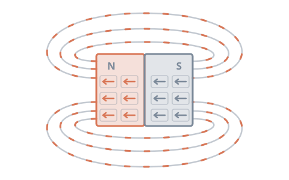
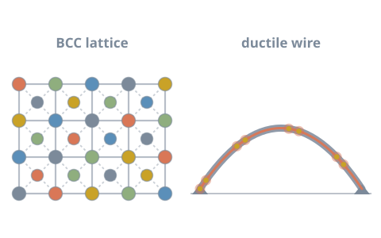
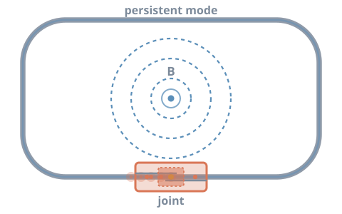

# Research

I study how processing and composition control the properties of functional materials.
My current focus is magnetic and superconducting materials, guided by machine learning.

## Research interests

- **Permanent magnets**: NdFeB magnets, from design to working prototype.
- **Superconductors**: ductile high-entropy superconductors for fusion, and
  MgB2 joints for MRI magnets.
- **Energy storage**: supercapacitor electrodes and related nanomaterials.
- **Machine learning for materials**: property prediction and inverse design.
  See [Machine Learning](machine-learning.md).

---

## Projects

Current

### NdFeB permanent magnets { #ndfeb }

The University of Queensland · 2026 – present

NdFeB magnets are the strongest permanent magnets in use today. I am developing an
NdFeB based magnet, from initial design through to a working prototype. The work
relates processing route and composition to magnetic performance.

[Read about NdFeB magnets in my blog →](blog/posts/ndfeb-magnets.md){ .project__link }

Current

### Ductile high-entropy superconductors for fusion { #hes }

The University of Queensland · 2026 – present

Fusion magnets need superconductors that can be shaped into wire without cracking.
I am developing a ductile superconductor based on high-entropy alloys for this purpose.
Machine learning guides which compositions to make, using the
[prediction and inverse design tools](machine-learning.md) I built.

[Read about high-entropy superconductors in my blog →](blog/posts/high-entropy-superconductors.md){ .project__link }

PhD · Completed

### MgB₂ reacted joints for persistent-mode MRI magnets { #mgb2 }

The University of Queensland · 2022 – 2026

An MRI magnet in persistent mode holds a stable field without a power supply. This
requires **superconducting joints** with extremely low resistance. My PhD developed a
fabrication method for **reacted MgB2 joints** for industrial MRI magnets.

I synthesised the MgB2 myself and formed each joint with a specialised
process. Joint performance was validated by its **transport critical current
(Ic)**.

Industry funded and under IP protection. Publications are on hold pending patent clearance.

[Read about MgB₂ joints in my blog →](blog/posts/mgb2-superconducting-joints.md){ .project__link }

MSc · Published

### Ternary hybrid supercapacitor electrode { #supercapacitor }

Bangladesh University of Engineering and Technology

I developed a **ternary hybrid electrode** of Ni(OH)2, MnO2 and
reduced graphene oxide (rGO). Its wrinkled, flower-like structure improved charge
storage. The work was published in **ACS Omega**.

[Read about supercapacitors in my blog →](blog/posts/supercapacitors.md){ .project__link }
[Read the paper →](https://pubs.acs.org/doi/10.1021/acsomega.2c01986){ target=_blank .project__link }

---

## Techniques & tools

=== "Synthesis & processing"

    - Arc melting and spark plasma sintering (SPS)
    - Powder metallurgy and inert-atmosphere heat treatment
    - MgB2 synthesis and reacted-joint fabrication
    - Nanomaterial synthesis (metal oxides and hydroxides, graphene) and electrode design

=== "Structural & imaging"

    - X-ray diffraction (XRD)
    - Electron microscopy: SEM, TEM, EDS, SAED
    - Focused ion beam (FIB)
    - XPS, Raman, FTIR and NMR spectroscopy
    - BET surface area analysis
    - Image segmentation for porosity analysis

=== "Magnetic & electrochemical"

    - Magnetic and transport measurements at cryogenic temperatures
    - Transport critical current (Ic) measurement
    - Cyclic voltammetry (CV), galvanostatic charge–discharge (GCD) and
      electrochemical impedance spectroscopy (EIS)

=== "Chemical analysis"

    - LC-MS and GC-MS
    - TXRF and XRF
    - Atomic absorption spectroscopy (AAS)
    - Wet chemistry under GLP, NATA and ISO 9001 requirements
